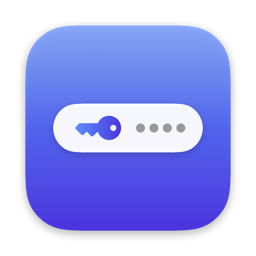
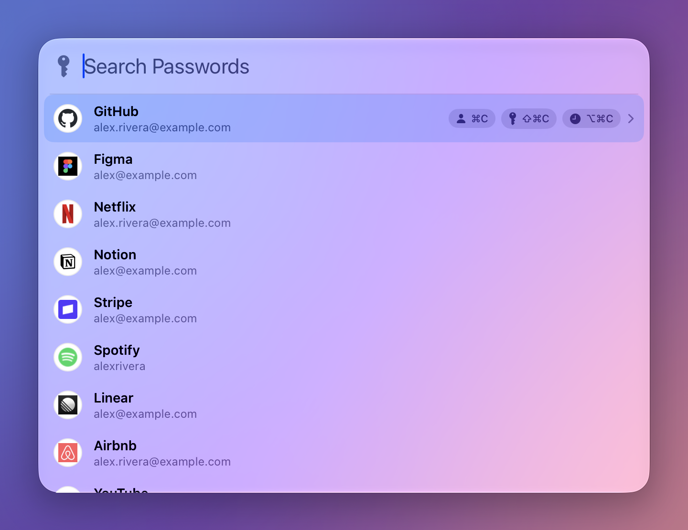
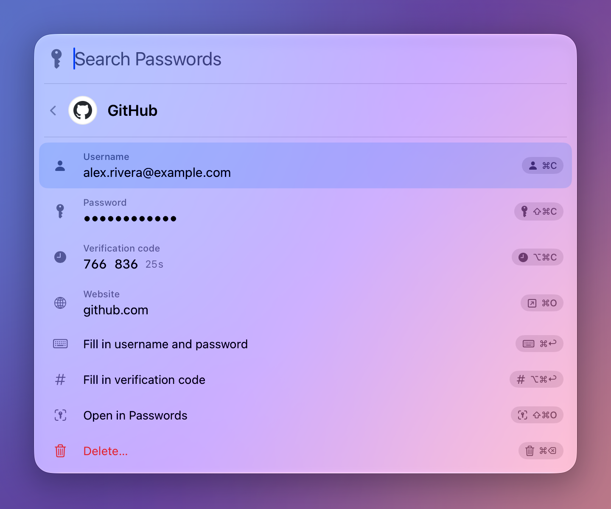
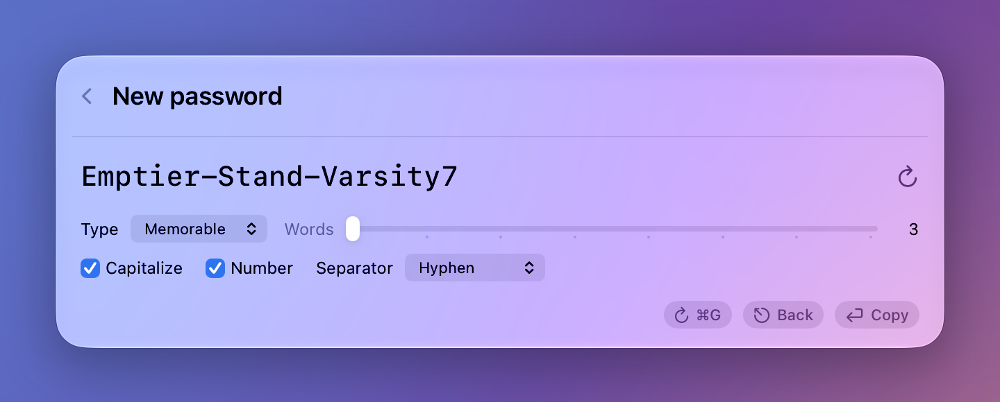
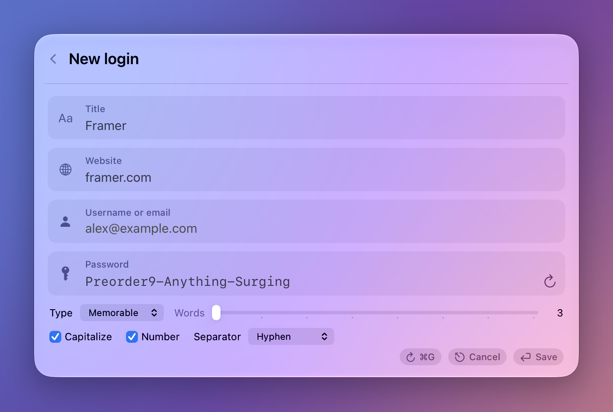

<p align="center">
  
</p>

<h1 align="center">QuickPass</h1>

<p align="center">Keyboard-driven quick access for Apple Passwords (formerly iCloud Keychain) on macOS.</p>

<p align="center">
  <a href="https://github.com/jessekhach/QuickPass/releases/latest"></a>
  
  <a href="LICENSE"></a>
</p>

<p align="center">
  <a href="https://github.com/jessekhach/QuickPass/releases/latest"><strong>Download for macOS</strong></a>
  &nbsp;·&nbsp;
  <code>brew install jessekhach/tap/quickpass</code>
</p>

<p align="center">
  
</p>

---

I switched from 1Password to Apple Passwords and missed one thing: pressing a shortcut and having my logins right there. QuickPass adds that.

It puts a global shortcut on Apple Passwords. Press ⌃⌥Space from any app, search your logins, and copy the username, password or verification code without opening the Passwords app. It can also generate passwords and save new logins to Passwords.

**Try it:** press ⌃⌥Space, type a few letters of a site, then ⇧⌘C. The password is on your clipboard.

## Features

- **Search from anywhere.** A floating search bar opens over the current app and searches every login in Apple Passwords.
- **Copy with one keystroke.** Username, password and 2FA code each have their own shortcut. The selected login stays selected for two minutes, so the next field is one keystroke away.
- **Current site suggestion.** Opened over Safari, Chrome, Arc, Brave, Edge or Vivaldi, QuickPass searches for the site in the current tab.
- **Autofill.** ⌘↩ types the username and password into the app QuickPass was opened over, and ⌥⌘↩ types the current verification code.
- **Password generator.** Memorable passphrases, random characters or PINs, with adjustable length and character sets.
- **Save new logins.** A short form creates the login in Apple Passwords and copies the new password for the sign-up form.
- **Website icons.** Each login shows its site's icon, fetched from the site itself. A scan in Settings or the welcome window finds the website for every login, and can be stopped and resumed.
- **Edit and delete.** Open any login in the Passwords app, or delete it with a confirmation step.
- **Touch ID.** Unlocking is handled by Apple Passwords. QuickPass asks for Touch ID as it opens when Passwords is locked.
- **Automatic updates** through Sparkle.

## Screenshots

<table>
  <tr>
    <td width="50%"></td>
    <td width="50%"></td>
  </tr>
  <tr>
    <td align="center">Search</td>
    <td align="center">Login details</td>
  </tr>
  <tr>
    <td></td>
    <td></td>
  </tr>
  <tr>
    <td align="center">Password generator</td>
    <td align="center">New login</td>
  </tr>
</table>

The screenshots use made-up logins.

## Keyboard shortcuts

| Shortcut | Action |
| --- | --- |
| ⌃⌥Space | Open or close QuickPass |
| ↑ ↓ | Select a login |
| ⌘C | Copy username |
| ⇧⌘C | Copy password |
| ⌥⌘C | Copy verification code |
| → | Show login details (← to go back) |
| ⌘O | Open the website |
| ⌘↩ | Fill username and password in the previous app |
| ⌥⌘↩ | Fill the verification code in the previous app |
| ⇧⌘O | Open the login in Passwords |
| ⌘⌫ | Delete the login (in details, confirmed with Return) |
| ⌘N | New login |
| ⌘G | Generate a password |
| ⌘, | Settings |
| Esc | Close |

All shortcuts for opening QuickPass and copying fields can be changed in Settings.

## Requirements

- macOS 15 (Sequoia) or later
- Apple Passwords with at least one saved login
- Accessibility permission (QuickPass asks for it on first launch)

## Installation

Download the latest DMG from [Releases](https://github.com/jessekhach/QuickPass/releases), open it, and drag QuickPass to Applications. Releases are signed with a Developer ID and notarized by Apple.

With Homebrew:

```bash
brew install jessekhach/tap/quickpass
```

On first launch, a welcome window walks through granting Accessibility access and unlocking Passwords once so QuickPass can read the list of logins.

## How it works

Apple Passwords has no public API. QuickPass reads and controls the Passwords app through the macOS Accessibility API, the same interface used by screen readers.

- **Titles and usernames** are read from the Passwords list and cached locally so search works before Touch ID.
- **Websites and verification codes** are read from the Passwords detail view while Passwords stays hidden.
- **Passwords** are copied with Passwords' own Copy Password command. Passwords only allows this while it is the active app, so it is activated for a fraction of a second with its window placed behind the QuickPass search bar.
- **New logins and deletions** go through Passwords' own New Password form and Delete command. When saving, QuickPass fills the form field by field, reads every field back, and only saves when all of them match.
- **Unlocking** uses the Touch ID prompt from Passwords itself.
- **The Passwords app** is quit once it locks again, so it does not stay in the Dock. This can be changed in Settings.

## Privacy and security

- QuickPass never writes passwords or verification codes to disk.
- The local cache in `~/Library/Application Support/QuickPass` contains titles, usernames and websites only, and is readable only by the current user.
- Passwords and codes fetched from Passwords are held in memory for up to two minutes, so one Touch ID covers a whole login, then discarded.
- Copied passwords and codes are marked as concealed so clipboard managers skip them, and are cleared from the clipboard after 60 seconds by default.
- QuickPass makes two kinds of network request: the daily update check against this repository, and website icons, which come straight from each site rather than an icon service, so no third party sees which sites you have logins for. Icons can be turned off in Settings.
- Updates are verified with an EdDSA signature in addition to Apple notarization.

See [SECURITY.md](SECURITY.md) to report a vulnerability.

## Limitations

- QuickPass depends on the layout of the Passwords app. A macOS update that changes Passwords may break QuickPass until it is updated.
- QuickPass is developed and tested on macOS 26. The macOS 15 version of Passwords gets less testing, so please open an issue if something fails there.
- Passwords locks itself shortly after moving to the background, so Touch ID is requested on most uses. The prompt can be moved from opening to first copy in Settings. Usernames are always available without it.
- Saving a new login takes a few seconds while the Passwords form is filled in. Typing in another app during that time can interfere.
- Current-site suggestions are not available in Firefox, which does not expose the tab address to other apps.

## Building from source

Requires Xcode 26 or later and [XcodeGen](https://github.com/yonaskolb/XcodeGen).

```bash
brew install xcodegen
git clone https://github.com/jessekhach/QuickPass.git
cd QuickPass
./build.sh
```

Set `DEVELOPMENT_TEAM` in `project.yml` to your own team ID before building. `build.sh` generates the Xcode project, builds a release build, installs it to `~/Applications` and launches it. A real signing certificate is required for development because macOS ties the Accessibility permission to the app's signature.

`scripts/release.sh` produces a signed, notarized DMG and adds it to the update feed (`appcast.xml`). It requires a Developer ID Application certificate, the Sparkle signing key in the keychain, and an App Store Connect API key passed as `ASC_KEY_PATH`, `ASC_KEY_ID` and `ASC_ISSUER_ID`.

## Project structure

```
Sources/QuickPass
├── App        app lifecycle, keyboard handling, search state, welcome window
├── Panel      search bar, login details, new-login form, password generator
├── Passwords  Passwords app integration, login model, password generator
├── Settings   preferences, shortcuts, Settings window
└── System     global shortcut, browser tab lookup, typing, menu bar icon, updates, website icons
```

`Passwords/PasswordsApp.swift` contains all of the Accessibility integration with the Passwords app.

## Contributing

Contributions are welcome. See [CONTRIBUTING.md](CONTRIBUTING.md).

## Support

QuickPass is free, and if it saves you time you can [sponsor it on GitHub](https://github.com/sponsors/jessekhach).

## License

QuickPass is released under the [GNU General Public License v3.0](LICENSE): you can use, change and share it, and any copy you share has to stay open source under the same license. The passphrase word list is the [EFF Large Wordlist](https://www.eff.org/dice) by the Electronic Frontier Foundation, used under [CC BY 3.0 US](https://creativecommons.org/licenses/by/3.0/us/).
